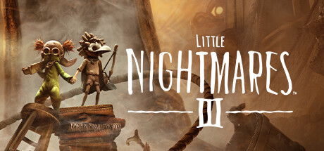

**Little Nightmares III follows Low and Alone navigating the Nowhere through a series of interconnected nightmarish worlds. Features co-op gameplay, new characters with unique abilities, and the most ambitious level variety in the series.**

---

## 📖 About

Little Nightmares III follows Low and Alone navigating the Nowhere through a series of interconnected nightmarish worlds. Features co-op gameplay, new characters with unique abilities, and the most ambitious level variety in the series.

## ⚠️ Problems Without Trainer

| Problem | Status |
|---------|--------|
| **Co-op Dependency** — Some puzzles designed explicitly for two players are awkward in solo mode | ✅ Solved |
| **New Character Abilities** — Learning both Low and Alone's unique tools requires adjustment | ✅ Solved |
| **Environmental Hazards** — New nightmare environments introduce unfamiliar danger types | ✅ Solved |
| **Chapter Length** — Some chapters are longer than Little Nightmares 1 and 2 combined | ✅ Solved |

## ✅ Solution

The **Little Nightmares III Trainer** solves all these issues by giving you complete control over the game.

## 🎯 Full Feature List

- Unlimited Resources
- God Mode / Invincibility
- Instant Skill Cooldown
- One-Hit Kill
- Freeze Game Timer
- Unlock All Items & Achievements
- Custom Speed Multiplier
- Save State Anywhere

## 🚀 Quick Start

1. **Disable Windows Defender** temporarily (trainer may trigger false positive)
2. Download the trainer from the button above
3. Launch Little Nightmares III
4. Run the trainer as Administrator
5. Activate desired cheats with hotkeys

## 💎 Free vs Paid

| Feature | Free | Pro |
|---------|------|-----|
| Basic God Mode | ✅ | ✅ |
| Unlimited Resources | ✅ | ✅ |
| All Advanced Cheats | ❌ | ✅ |
| Auto-Updates | ❌ | ✅ |
| Priority Support | ❌ | ✅ |

## 💻 Requirements

- Windows 10/11 (64-bit)
- Little Nightmares III (any version)
- .NET Framework 4.8+
- DirectX 11+

## 🍎 macOS

macOS users can use our alternative tool:

## ⚖️ Legal

This trainer is for educational and single-player use only. Use responsibly.

---

